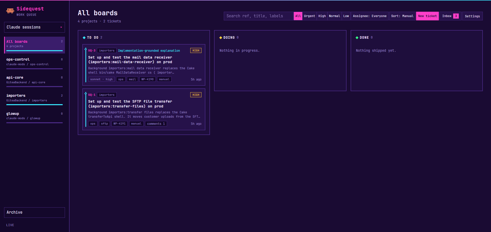

# ops-control




A Claude Code plugin marketplace with three plugins that work together. **Requires Claude Code 2.1.289 or later; tested with Claude Code 2.1.304** on Linux, WSL and macOS. By [Hanafubuki](https://github.com/Hanafubuki), MIT licensed.

| Plugin | What it is | Based on |
|---|---|---|
| [**Ops Control**](plugins/ops-control) | A cockpit pane beside the transcript (Plan, Context, Guardrails, Agents, Diff, Music, Settings), a work bar over the prompt with milestones and context, **interactive guardrails** you switch on and off, name packs and pets, `/opstask` and `/opspin`, and keyboard navigation | [glowup](https://github.com/NovusEdge/glowup) v1.2.0 by Aliasgar Khimani |
| [**Sidequest**](plugins/sidequest) | A local work board and orchestration loop for Claude Code, here with the arcade dashboard restyle, a Claude sessions page and comment edit/delete | [Sidequest](https://github.com/Eigenwise/eigenwise-toolshed/tree/main/plugins/sidequest) v6.0.2 by Eigenwise |
| [**prismantis**](plugins/prismantis) | Colorful, themeable rendering of Claude's replies: tables, headings, code, diagrams | [prismantis](https://github.com/NahumLitvin/prismantis) v0.31.1 by Nahum Litvin |

## Contents

- [Install](#install)
- [Keyboard (Ops Control)](#keyboard-ops-control)
- [The tabs (Ops Control)](#the-tabs-ops-control)
- [Guardrails (Ops Control)](#guardrails-ops-control)
- [Packs (Ops Control)](#packs-ops-control)
  - [Set a package](#set-a-package)
  - [Create a package: the easy way](#create-a-package-the-easy-way)
  - [Create a package: by hand](#create-a-package-by-hand)
  - [Create a look pack](#create-a-look-pack)
- [Versions](#versions)
- [What else is here](#what-else-is-here)
- [Licences](#licences)

## Install

One command installs all three plugins (Claude Code 2.1.289 or later, on Linux, macOS or WSL):

```sh
curl -fsSL https://raw.githubusercontent.com/Hanafubuki/ops-control/main/install.sh | sh
```

It adds this marketplace (or updates it), installs `ops-control`, `sidequest` and `prismantis` from it, and writes `~/.claude/keybindings.json` with Ops Control's shortcuts (Alt+1–7 and the arrows) if you have none yet; an existing one is left alone. Restart Claude Code afterwards. To read the script first, open [install.sh](install.sh).

If you used glowup, Sidequest or prismantis from their own marketplaces before, add `--replace` so those copies are uninstalled first and nothing loads twice:

```sh
curl -fsSL https://raw.githubusercontent.com/Hanafubuki/ops-control/main/install.sh | sh -s -- --replace
```

To install a specific release instead of the latest, add `--version` (see [Versions](#versions)):

```sh
curl -fsSL https://raw.githubusercontent.com/Hanafubuki/ops-control/main/install.sh | sh -s -- --version v1.0.0
```

Or install them one by one from inside Claude Code:

```text
/plugin marketplace add Hanafubuki/ops-control
/plugin install ops-control@ops-control
/plugin install sidequest@ops-control
/plugin install prismantis@ops-control
```

On its first start Ops Control copies your packs, themes, pets and name packs from `~/.claude/glowup` to `~/.claude/ops-control`. Settings kept in Claude Code's plugin storage (the current look, level and XP, the chosen name pack) start fresh.

## Keyboard (Ops Control)

| Key | Where | What it does |
|---|---|---|
| **Alt+1 … Alt+7** | anywhere, the prompt included | switch to the 1st–7th tab and give the pane the keyboard |
| **← / →** | in the pane | previous / next tab |
| **↑ / ↓** | in the pane | previous / next control inside the tab |
| **Enter** | on a control | press it; on a dropdown, open or close it |
| **Esc** | in the pane | back to the prompt |

These come from a few lines in `~/.claude/keybindings.json`, which `install.sh` writes when you have none; otherwise add them yourself, as shown in [Ops Control's README](plugins/ops-control/README.md#keyboard).

## The tabs (Ops Control)

The pane docks beside the transcript in fullscreen on a wide terminal (144 columns, or 110 once you have opened it). On a narrower one, `/ops pane` opens it as a drawer above the prompt. Its seven tabs, in order (Alt+1 … Alt+7):

| # | Tab | What it shows | What you can do there |
|---|---|---|---|
| 1 | **Plan** | Every request you made this session, newest on top, with its status, then Claude's task list. | Open a request to see its objective, its milestones, what was done, its **issues** (tool calls that failed or were refused and aren't fixed yet), and the questions and action items left for you. Requests made before Ops Control loaded are read back from the transcript. |
| 2 | **Context** | How full the context window is: a bar split by what fills it, a chart over the session, the turns left before auto-compact, and the heaviest sources you could trim. Below that, **CPU and RAM** (Linux, WSL and macOS, refreshed every 3 seconds while the tab is open) and your **5-hour and weekly** plan usage with reset times (or this session's cost on an API key). | Read only. |
| 3 | **Guardrails** | The rules the project gives agents (CLAUDE.md, AGENTS.md, GUARDRAILS.md, `.claude/rules`, `.claude/agents`, skills, `agent_rules`, Cursor rules), then Ops Control's own guardrails: Edits outside project, Deleting files, Downloads, Package installs, Git push, Deploy & publish (Ask first), Force push & resets and Dangerous commands (Never). | Every rule has an on/off switch (↑/↓, then Enter), kept per project. An Ops Control guardrail switched **on** is enforced: a matching call is put to you to approve, even in auto mode, or refused for a Never (all start off). A project rule switched **off** is one Claude is told to disregard at your next prompt, and again after `/compact` (all start on). |
| 4 | **Agents** | The main session first (`★`), then every subagent with its time, tokens and current step, named after the active pack's cast. | Open one for its detail view: what it was asked, a **Context** meter for its own window, its **Milestones**, what it is doing **Now** and its latest **Steps**. `‹ All agents` (or `q`) goes back. |
| 5 | **Diff** | The files Claude edited or created, newest first, with added and removed line counts, and their changes as hunks. A commit removes the committed files. | Read only. |
| 6 | **Music** | What is playing on your machine (any player on Linux; Windows media sessions on Windows and WSL; `media-control` or Spotify on macOS), with a progress bar. | Prev / Pause / Next (`r`, `p`, `n`). While music plays the pet dances. |
| 7 | **Settings** | The controls below. | Each control is reached with ↑/↓ and pressed with Enter. |

**Settings controls:**

| Control | What it does |
|---|---|
| **Open board** (`b`) | Starts the Sidequest board if it isn't running and opens it in your browser. |
| **Theme** (dropdown, e.g. `Arcade ▾`) | Picks the colour theme. Sidequest's palettes come first (Arcade, Clean, Tokyo Night, four Catppuccin flavours), then Ops Control's own themes and yours. |
| **Package** (dropdown, e.g. `Code Geass ▾`) | Picks the name pack: how the main session and subagents are named, and which character the pet shows. Its last entry, **+ Create pack…**, makes a new one (see below). |
| **Character** (`c`, `Shown · Hide` / `Hidden · Show`) | Shows or hides the pet. |

A dropdown opens and closes with Enter (or a click). While it is open, ↑/↓ move only through its options, and nothing changes until you press Enter on one.

Above the prompt, the **work bar** shows what Claude is doing toward the current milestone, the milestones as a track (`●━●━◉─○─○ 2/5`), the context meter and the 5-hour limit. Only the current task's milestones show: a new request starts with an empty track until Claude records its own. When you open a subagent's transcript, the bar shows that subagent's own milestones and context.

## Guardrails (Ops Control)

The Guardrails tab isn't just a list to read: every rule in it has a **switch**, and the switches change what happens. Open it with **Alt+3**, move to a rule with ↑/↓ and press **Enter** (or click it) to flip it. Your choices are saved for each project folder.

```text
╭─ GUARDRAILS ─────────────── 3 rules (1 off) · 2 enforced ─╮
│ Project rules  off: Claude is told to disregard it        │
│ CLAUDE.md  3                                              │
│ ● on  ■ Never commit .env files                           │
│ ○ off ■ Always write tests before code                    │
│ ● on  □ Prefer small pull requests                        │
│                                                           │
│ Ops Control guardrails  on: enforced                      │
│ ● on  Git push               Ask first                    │
│ ● on  Force push & resets    Never                        │
│ ○ off Package installs       Ask first                    │
╰───────────────────────────────────────────────────────────╯
```

| Kind | Switched on | Switched off |
|---|---|---|
| **Ops Control guardrails**: Edits outside project, Deleting files, Downloads, Package installs, Git push, Deploy & publish (*Ask first*); Force push & resets, Dangerous commands (*Never*) | **Enforced.** A matching call (a `git push`, an `npm install`, an edit outside the project…) is put to you to approve, even in auto mode, or refused outright for a *Never*. | Not enforced; Claude Code decides as usual. All start **off**. |
| **Project rules**, read from CLAUDE.md, AGENTS.md, GUARDRAILS.md, `.claude/rules`, `.claude/agents`, skills, `agent_rules` and Cursor rules | Claude follows the rule as written. All start **on**. | At your next prompt Claude is told to disregard that rule for this project, and told again after a `/compact`. Switching it back on tells Claude to follow it again. |

A project rule stays in its file, which Claude still reads; the switch tells Claude to set it aside. To remove a rule for good, edit the file. Rules Claude Code decides on its own (project edits, network access, git commits) are listed without a switch.

## Packs (Ops Control)

Ops Control has two kinds of pack. They are unrelated and live in different folders:

| | **Package** (name pack) | **Look pack** |
|---|---|---|
| Sets | the main session's name, the subagents' names, the pet's character | colours, transcript row styles, borders, spinner, motion |
| Folder | `~/.claude/ops-control/namepacks/<id>.json` | `~/.claude/ops-control/packs/<name>.json` |
| Pick it with | Settings → **Package** | `/ops pack <name>` |

If `CLAUDE_CONFIG_DIR` is set, both folders are under it instead of `~/.claude`.

### Set a package

Open the pane, press **Alt+7** (Settings), go down to **Package**, press Enter, pick one with ↑/↓ and press Enter. The built-in packages:

| Package | Main session | Pet | Cast |
|---|---|---|---|
| Default | Main session | your own pet | none: agents keep their own names |
| Code Geass | Lelouch | lelouch | 37 names (C.C., Suzaku, Rolo…) |
| Naruto | Shikamaru | shikamaru | 39 names (Naruto, Sasuke…) |
| Jujutsu Kaisen | Gojo | gojo | 35 names (Yuji, Megumi…) |
| Attack on Titan | Levi | levi | 37 names (Eren, Armin…) |

Each new subagent gets the next unused name in the cast and keeps it for the session, even if you switch packages. When the cast runs out, names come round again with a numeral ("Suzaku II"). A new session starts from the top of the cast.

### Create a package: the easy way

1. In Settings, open **Package** and choose **+ Create pack…**.
2. Describe it, for example `One Piece, Luffy leads`, and press **create**.
3. Ops Control asks Sonnet for a name, the lead and a cast of 24–40 names, then asks Opus to draw the lead as a 24×12 pixel pet. It saves the package to `~/.claude/ops-control/namepacks/<id>.json` and the pet to `~/.claude/ops-control/pets/<id>.json`, and switches to it.
4. If the pet can't be drawn, the package is still saved and your own pet stays.

These are ordinary model calls on your account.

### Create a package: by hand

Save a file such as `~/.claude/ops-control/namepacks/one-piece.json`:

```json
{
  "format": 1,
  "id": "one-piece",
  "label": "One Piece",
  "main": "Luffy",
  "pet": "luffy",
  "description": "The Straw Hat crew",
  "cast": ["Zoro", "Nami", "Usopp", "Sanji", "Chopper", "Robin", "Franky", "Brook"]
}
```

| Field | Required | Rules |
|---|---|---|
| `format` | yes | must be `1` |
| `id` | yes | lowercase letters, digits and dashes, starting with a letter or digit, at most 40 characters; not a built-in package's id. Use the file name. |
| `label` | yes | the name shown in the Package list; cut to 40 characters |
| `main` | yes | the main session's name; cut to 30 characters |
| `cast` | yes | the subagent names in order: **at least 8**, anything past 60 is dropped, each cut to 30 characters; duplicates and the `main` name are removed |
| `pet` | no | the character to show: a built-in pet (`clawd`, `robot`, `ghost`, `lelouch`, `shikamaru`, `gojo`, `levi`) or a pet file in `~/.claude/ops-control/pets/`. Leave it out to keep your own pet. |
| `description` | no | a note for yourself; cut to 400 characters |

Comments (`//`) are allowed. A file that breaks a rule is skipped without a message, so if your package doesn't show up in the list, check it against this table. Reopen the Settings tab, or run `/reload-plugins`, to pick it up.

### Create a look pack

A look pack can `extends` another and list only what it changes:

```json
{
  "format": 1,
  "name": "arcade-soft",
  "extends": "arcade",
  "description": "arcade, less pink",
  "colors": { "palette": { "accent": "#d46fb0" } }
}
```

Save it as `~/.claude/ops-control/packs/arcade-soft.json` (the `name` must match the file name and can't be `classic`, `crt`, `cozy` or `arcade`), then:

```text
/ops pack arcade-soft
```

The easiest way to make one is to ask Claude, for example "make me an Ops Control pack from this palette" or "make arcade less pink"; the bundled `ops-control-pack` skill writes the file. `/ops import <file>` turns a Ghostty or base16 colour scheme into a pack. Every field is listed in [the pack reference](plugins/ops-control/docs/pack-reference.md).

## Versions

Each release is a git tag (`v1.0.0`, `v1.1.0`, …) with notes on the [Releases page](https://github.com/Hanafubuki/ops-control/releases) and in [CHANGELOG.md](CHANGELOG.md). Version numbers follow [semantic versioning](https://semver.org): a major number for changes that break how you use it, a minor for new features, a patch for fixes. The `version` of Ops Control in the marketplace matches the release; Sidequest and prismantis keep their own upstream version numbers.

- **Latest:** `/plugin marketplace add Hanafubuki/ops-control` (or the one-command install) follows `main`, and `/plugin marketplace update ops-control` brings in new releases.
- **A specific release:** pin the marketplace to its tag, then install as usual:

```text
/plugin marketplace add Hanafubuki/ops-control#v1.0.0
/plugin install ops-control@ops-control
```

To move to another release later, remove the marketplace (`/plugin marketplace remove ops-control`) and add it again with the new tag, or run `install.sh --version <tag>`, which does that for you. A pinned marketplace stays on its release when you run `/plugin marketplace update`.

## What else is here

| Path | What it is |
|---|---|
| [`tools/sidequest-arcade`](tools/sidequest-arcade) | The patch kit behind Sidequest's arcade dashboard: `arcade.patch` and `server.patch` against the stock sources, the patched source in `work/`, and `apply.sh`, which re-applies the restyle after a Sidequest update. The plugin in `plugins/sidequest` already ships the built dashboard. |
| [`tools/sidequest-sessions`](tools/sidequest-sessions) | The builder for the dashboard's **Claude sessions** page: it reads your Claude Code transcripts and Ops Control's request lists and writes the page's data under `~/.claude/sidequest-sessions/data`. Run from session hooks; see its README. |

## Licences

Everything here is MIT. Each plugin keeps its own `LICENSE` and copyright notice; [LICENSE](LICENSE) covers the rest of the repository.
