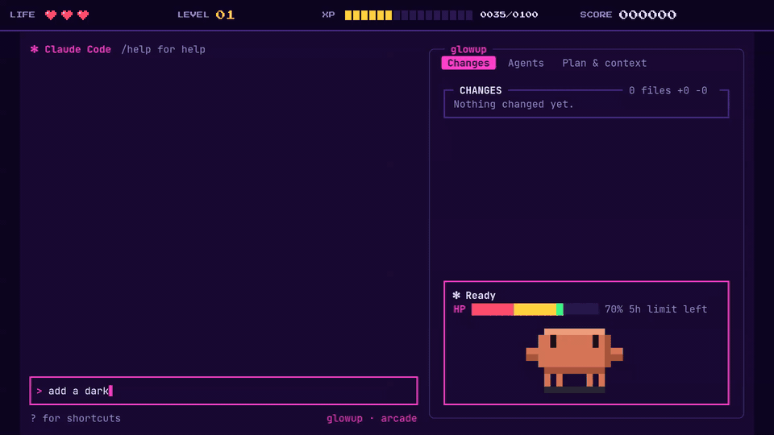
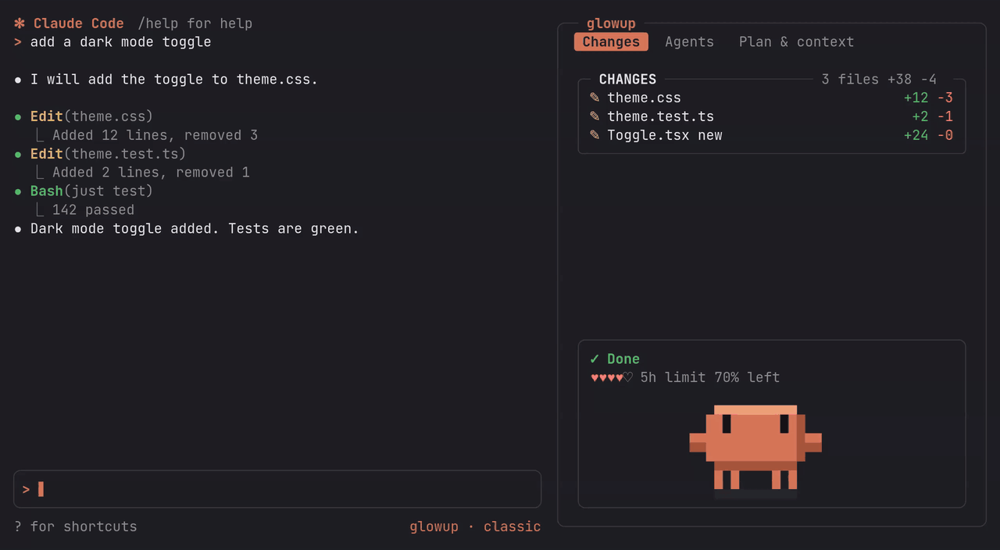
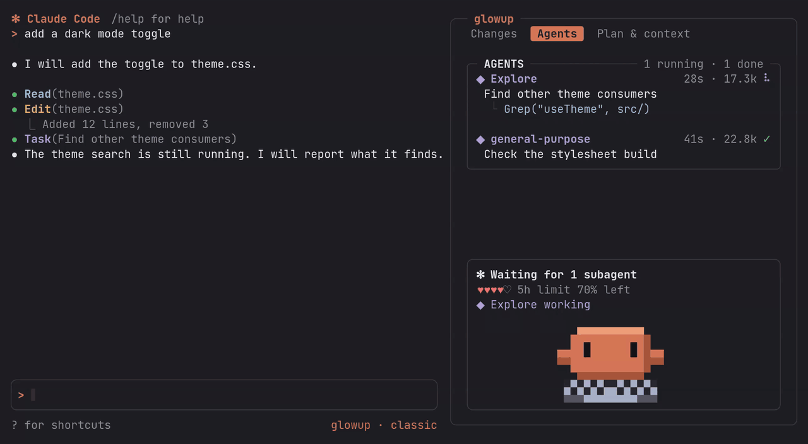
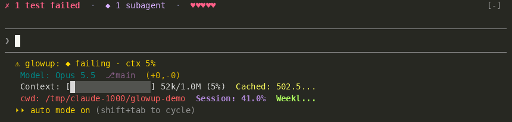
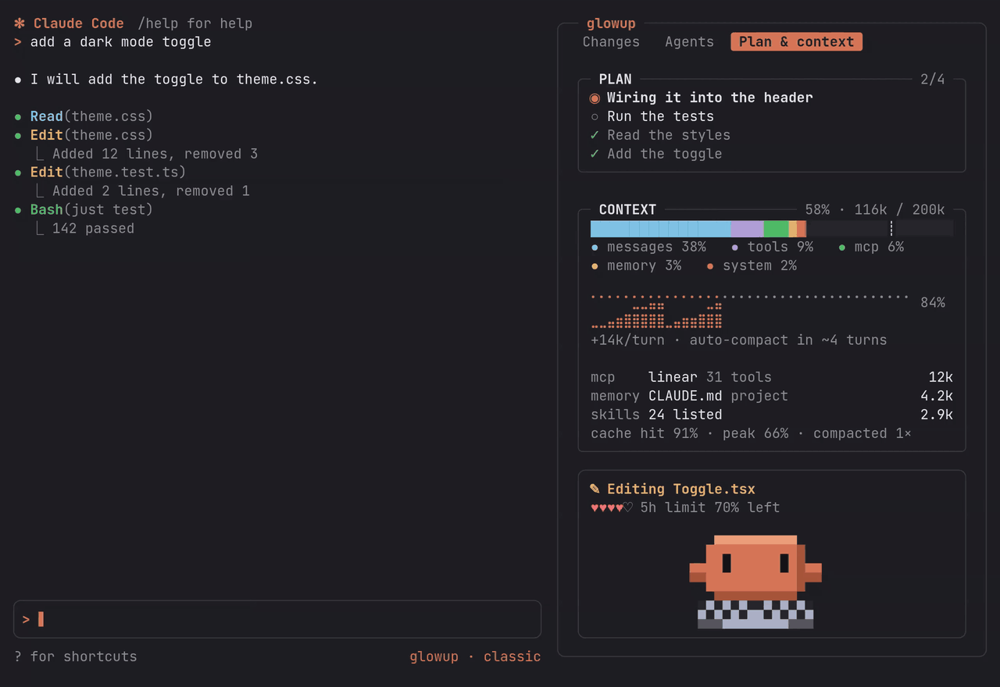
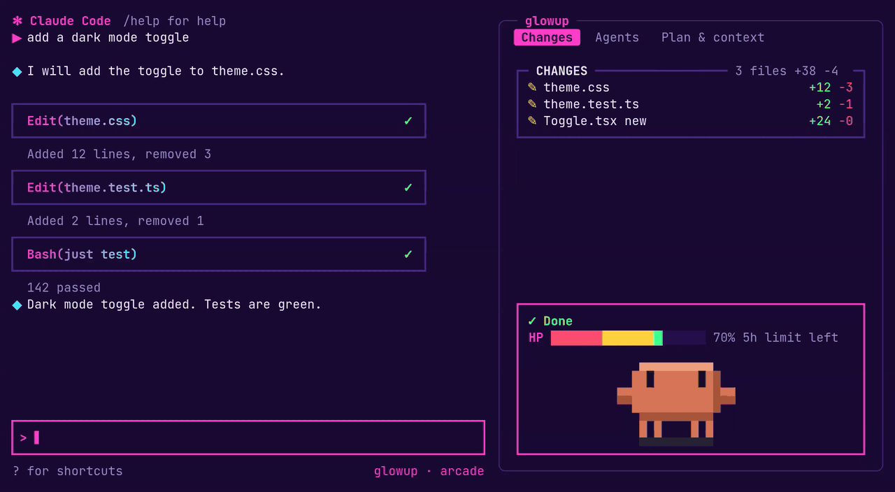


<div align="center">

# Ops Control

A Claude Code mod that adds a side pane for changed files, subagents and context use, an activity line above the prompt, packs and themes written as JSON, and a pixel pet named Clawd.

[](LICENSE)
[](docs/install.md)

By [Hanafubuki](https://github.com/Hanafubuki), MIT licensed. Based on [glowup](https://github.com/NovusEdge/glowup) by Aliasgar Khimani (MIT). Tested with Claude Code 2.1.304. Part of the [ops-control](https://github.com/Hanafubuki/ops-control) marketplace, with Sidequest and prismantis.

</div>



<p align="center"><sub>A cut of the launch video, in the arcade pack with the pane docked: Claude edits a file, a test fails and costs a life, the fix passes, and Clawd hops as the level goes up. The full video also switches packs and shows the Plan &amp; context tab.</sub></p>

Ops Control draws around Claude Code's transcript and prompt without moving them.

## What you get

<table>
<tr>
<td width="50%" valign="top">

### The pane

The pane's tabs open on Plan, each drawn as a box in your pack's border style.

- **Diff** lists the files Claude edited or created, newest first, with added and removed line counts from git, and shows their changes as hunks, with added and removed lines in your theme's colors. A commit drops the committed files.
- **Agents** lists the main session first, then the subagents with their elapsed time, token count and the tool each one is running. Click one to see what it was asked, what it is doing now and its latest steps.
- **Plan** lists every request you made this session, newest on top; click one to see its status, objective, milestones, its issues (calls that failed and nothing fixed yet, or were refused, and the ones fixed later), what was done, and the questions and action items left for you. Claude's task list sits under them. Requests from before Ops Control loaded in a session are read back from its transcript, and a prompt sent while Claude worked on another shows that request's milestones.
- **Context** shows a context bar split by what is filling the window, a chart of context use over the session, how many turns remain before auto-compact, and the heaviest sources you can trim.
- **Guardrails** lists the rules the project sets for agents, read from CLAUDE.md, AGENTS.md, GUARDRAILS.md, `.claude/rules`, `.claude/agents`, skills, `agent_rules` and Cursor rules. Below them are Ops Control's own guardrails (installs, pushes, deploys, downloads, deletes, edits outside the project, force pushes, dangerous commands). Every rule has an on/off switch, kept per project: a Ops Control guardrail switched on is enforced (the call is put to you, or refused), and a project rule switched off is one Claude is told to disregard.
- **Music** shows what is playing on your machine, with a progress bar and Prev, Pause and Next buttons (`r`, `p` and `n` while the pane has the keyboard), and the app's name in the header. It needs no login: on Linux any MPRIS player (Spotify, a browser tab, VLC) through `busctl` or `playerctl`; on Windows and under WSL any app in Windows' media sessions, a YouTube tab included; on macOS any app's Now Playing with `media-control` installed (`brew install media-control`), else Spotify through `osascript`. While music plays, your pet dances, and wears headphones while Claude works.
- **Settings** opens the Sidequest board in your browser (starting it when it is not running), picks the theme (the Sidequest board's palettes are Ops Control themes too: arcade, clean, tokyo-night and four Catppuccin flavors), picks the name pack, and shows or hides the pet.

**Name packs** name your agents. Default keeps Ops Control's own names and your pet. Code Geass, Naruto, Jujutsu Kaisen and Attack on Titan call the main session Lelouch, Shikamaru, Gojo or Levi, put that character on the pet, and name each new subagent after the next one in the cast (C.C., Suzaku, Rolo…); once the cast is used up the names come round with a numeral. *Create pack…* at the end of the list takes a description, and a model writes the cast and draws the main character as a pet; the pack is saved in `~/.claude/ops-control/namepacks` and its pet in `~/.claude/ops-control/pets`.

Under the tabs, a status box shows the current action, the running subagents, and a row of hearts for the usage you have left on whichever of the 5-hour and weekly limits is tighter. On an API key the row shows what the session has spent instead.

</td>
<td width="50%" valign="top">



<sub>The status box below the tabs: Done, the usage hearts, and Clawd (shown on the Changes tab of an earlier version; its file list is now at the top of the Diff tab).</sub>

</td>
</tr>
<tr>
<td width="50%" valign="top">



<sub>Agents tab: one subagent mid-grep, one finished.</sub>

</td>
<td width="50%" valign="top">

### The work bar

Two rows above the prompt, docked pane or not. The first says what Claude is doing toward the work's milestones, the step it is at and how long that step has run, with the open issues and running subagents at its right end. The second shows the milestones as a track (`●━●━◉─○─○ 2/5`), the context meter with the auto-compact point marked, and the 5-hour limit with the time to its reset. Claude reports the milestones through Ops Control's own `milestones` tool, or Control Room's when that plugin is on.

**Time left.** While Claude works, the track ends with a guess at how long the work still needs: `●━●━◉─○ 2/4 · ETA ~6m`. Ops Control notes when each milestone starts and finishes (Claude doesn't supply these times), takes the time from the first start to the latest finish, divides it by the milestones done, and multiplies by the ones still open. The milestone at work counts minus what it has already run, but never less than a fifth of that average. Until a milestone is done it shows `ETA --`. While a milestone is waiting or blocked, and between turns, nothing is shown, because the headline already says what the work waits on. It's only an estimate from the pace so far: a long test run or a large last milestone makes it jump. In a narrow bar the `ETA` label drops and only `· ~6m` stays.

Without milestones there's still an estimate, from the best source available:

| The work has | The estimate comes from |
|---|---|
| Milestones | their pace, as above |
| Only Claude's task list | the same pace, from when each task started and finished as the bar saw them |
| Neither, or steps with none done yet | past finished requests, from this session and the up to 60 newest saved sessions (read once per session from `~/.claude/ops-control/requests/`): of the ones that ran longer than this one has so far, the middle one's time, minus the time already run. Drawn dim, since it's looser. It needs at least 3 finished requests, and shows `ETA --` once this request has run longer than all of them. |

With no steps the bar shows the estimate on its own (`ETA ~4m`), next to the context meter.

`/ops setup bar band` swaps it for the one-row band: while Claude works, the current action, running subagents, plan progress, and five hearts for the context left, each worth 20% of the window.



</td>
</tr>
<tr>
<td width="50%" valign="top">



<sub>Plan & context tab, one compaction into the session.</sub>

</td>
<td width="50%" valign="top">

### The context box

The context box shows what is filling the window and when it will run out.

- The `┊` on the bar and the dashed line on the chart mark where auto-compact runs.
- The line under the chart gives the growth per turn and the turns left before auto-compact.
- Below that are the three biggest sources you can trim, such as an MCP server's tools, a `CLAUDE.md` or the skill listing.

</td>
</tr>
<tr>
<td width="50%" valign="top">

### Packs and themes

A pack sets colors, transcript row styles, border shape and spinner under one name. A theme is just the palette part: colors, a few glyphs, spinner words and the heart characters. Both are JSON files that can `extends` another, so a custom one only lists what it changes, and either can be shared by hosting the file at an `https://` URL.

</td>
<td width="50%" valign="top">

### The status line

While Claude or a subagent is working, Ops Control adds an entry under the prompt and clears it when the work is done. Its fields and their order are yours to pick, from activity, context, 5-hour and weekly usage, cost, branch, the track playing in Spotify and a few more. On first run Ops Control asks once whether it should draw your whole status line; if you say no, your existing one is left alone.

</td>
</tr>
</table>

## Install

Ops Control needs Claude Code 2.1.289 or later and is tested with Claude Code 2.1.304. From inside Claude Code:

```text
/plugin marketplace add Hanafubuki/ops-control
/plugin install ops-control@ops-control
```

The same marketplace also has Sidequest (`/plugin install sidequest@ops-control`) and prismantis (`/plugin install prismantis@ops-control`). If you used glowup before, uninstall it (`/plugin uninstall glowup@glowup`) so the two do not draw twice; on its first start Ops Control copies your packs, themes, pets and name packs over from `~/.claude/glowup`.

If you see `Failed to load hooks ... expected record, received undefined`, or Ops Control does not show up, see [If Ops Control does not load](docs/install.md#if-ops-control-does-not-load).

To run from a clone:

```sh
git clone https://github.com/Hanafubuki/ops-control
cd ops-control/plugins/ops-control
claude --plugin-dir .
```

If a session loads both an installed copy and a clone, the clone wins and the installed copy turns itself off. `/ops config` opens glowup's settings screen, a prebuilt program downloaded from glowup's releases, so its title still reads glowup. [Install](docs/install.md) covers settings and removal.

## Using it

`/opspin <text>` pins a note over the prompt (`/opspinclear` removes them all), and `/opstask <request>` has Claude do the request and then file the result as a Sidequest task. A fork started with `/subtask` shows in the Agents tab. Everything this copy adds since v1.2.0, and how to make name packs and look packs, is in [CUSTOMIZATIONS.md](CUSTOMIZATIONS.md).

### Keyboard

| Key | Where | What it does |
|---|---|---|
| **Alt+1 … Alt+7** | anywhere, the prompt included | switch to the 1st–7th tab (Plan, Context, Guardrails, Agents, Diff, Music, Settings) and give the pane the keyboard |
| **← / →** | in the pane | previous / next tab, wrapping at the ends |
| **↑ / ↓** | in the pane | previous / next control inside the tab; ↑ from the first control goes to the tab strip, ↓ from the strip goes into the tab; with no further control, the tab's content scrolls |
| **1 … 7** | in the pane | jump to that tab |
| **Enter** | on a control | press it; on a Settings dropdown, open or close it (the arrows stay inside an open dropdown) |
| **Esc** | in the pane | hand the keyboard back to the prompt |

Alt+1–7 and ←/→ come from `~/.claude/keybindings.json`:

```json
{
  "$schema": "https://www.schemastore.org/claude-code-keybindings.json",
  "bindings": [
    { "context": "Global", "bindings": { "alt+1": "diff:back", "alt+2": "diff:previousSource", "alt+3": "diff:nextSource", "alt+4": "diff:previousFile", "alt+5": "diff:nextFile", "alt+6": "modelPicker:thisSessionOnly", "alt+7": "effortSlider:thisSessionOnly" } },
    { "context": "Pane", "bindings": { "left": "pane:pageUp", "right": "pane:pageDown" } }
  ]
}
```

A mod cannot define key actions of its own, so each tab button is linked to an engine action that the engine only handles inside its diff, model-picker and effort dialogs; anywhere else the bound key presses the tab. ← and → are bound to the pane's page scroll, which Ops Control turns into a tab step, so PageUp/PageDown and Home/End switch tabs in the pane as well. Plain F-keys cannot be used: the engine only hands keys with a modifier (Alt, Ctrl, …) to a mod. After editing `keybindings.json`, restart Claude Code if the keys don't respond.

`/ops` on its own lists the handful of commands most people need, and `/ops config` opens a settings screen in a new terminal window where you pick a pack, spinner and pet, type exact colors, and set up the band, tabs and status line. Everything else, including installing shared packs and themes, overriding single colors and exporting to Konsole, is in [Commands](docs/commands.md).

Ops Control's settings also appear in Claude Code's `/plugin` menu. A change there and a `/ops` command set the same saved choice, so whichever you made last is the one in effect. Changes made in `/plugin` apply at the next session start or after `/reload-plugins`.

## Packs and themes

Four packs ship: classic (the default, which keeps Claude Code's own look), crt, cozy and arcade.

```text
/ops pack arcade
```



You can mix parts of different packs, put one of seven color themes on top, or override single colors. To make your own, ask Claude: Ops Control ships a skill that writes packs from a palette, an image or a description, and adjusts existing ones ("make arcade less pink"). `/ops import` also converts Ghostty and base16 color schemes.

See [Packs](docs/packs.md) and [Making a theme](docs/themes.md).

## Clawd



Clawd lives at the bottom of the pane and reacts to the session. He types while Claude edits or runs commands, walks while it reads and searches, juggles when three or more subagents are running, hops on a passing test and sweats on a failing one. He waits with a question mark when Claude needs your approval, pants once context passes 80%, and falls asleep after a minute of nothing. With bubbles on he also says a short line at the end of a turn or when something fails.

Reduced motion hides him, as does `/ops pet off`. [Pets](docs/pets.md) lists every reaction, the outfits, and what Haiku-written bubbles send.

## Layout

In fullscreen on a wide terminal (144 columns, or 110 once you have opened it yourself) the pane docks beside the transcript. On narrower terminals you get the band instead, and `/ops pane` opens the pane as a drawer above the prompt. Under 80 columns both shrink to fit:


See [Layout](docs/layout.md).

## Accessibility

- `/ops motion reduced` (or the `reducedMotion` setting) switches to the stock spinner, turns off the shimmer and hides Clawd. With motion on, nothing flashes more than 2.5 times a second.
- The high-contrast theme uses pure white text and fully saturated colors.
- Every state has a glyph and a word as well as a color.

See [Accessibility](docs/accessibility.md).

## Roadmap

Planned, without dates: sound and voice layers for packs, more spinners, two more pets (Kit and Blip), and opening a subagent from the Agents tab. See [Roadmap](docs/roadmap.md).

## Contributing

`just setup` installs dependencies, `just ci` runs the same checks as CI, and `just dev` starts Claude Code with your checkout loaded. See [CONTRIBUTING.md](CONTRIBUTING.md), and report vulnerabilities as described in [SECURITY.md](SECURITY.md).

## License

[MIT](LICENSE)
