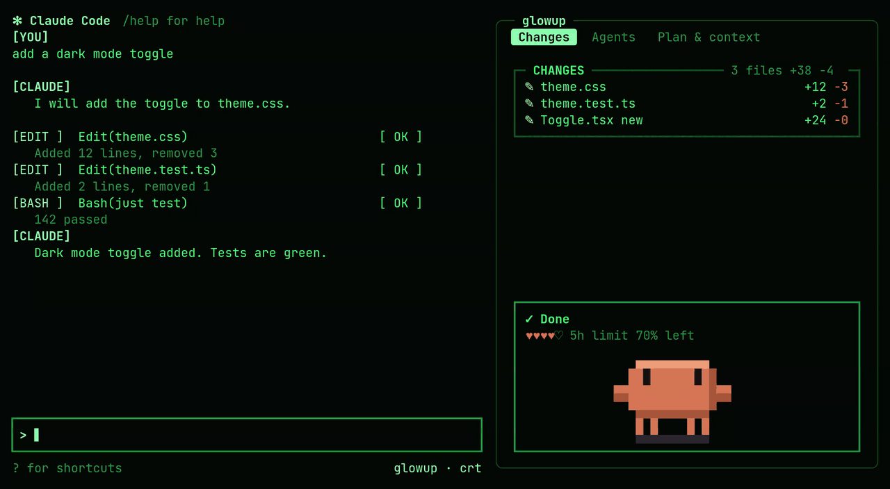
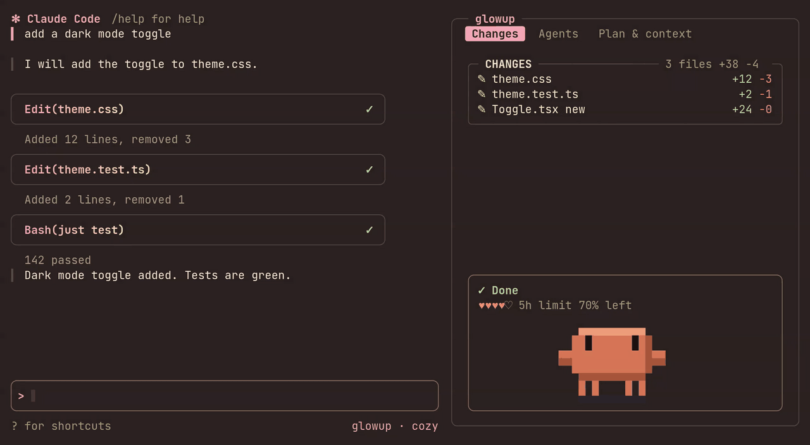

A pack decides how Ops Control looks: the colors, how your prompts and Claude's replies are framed in the transcript, the border style of the pane, and the spinner. Switching packs restyles all of it at once.

```text title="claude code"
/ops pack arcade
```

## The built-in packs

**classic** is the default. It keeps Claude Code's own look and only adds Ops Control's pane, band and pet.

**crt** is green phosphor on near-black, with retro tags such as `[YOU]` and `[ OK ]` on the transcript rows and a comet spinner.



**cozy** uses warm pastels, rounded cards with a pink-to-cream gradient, and a spinner made of two blinking eyes.



**arcade** is neon on deep purple. Rows get bold cards with arrow and diamond markers and an XP tag, the context hearts become an HP bar, a combo counter climbs as tool calls succeed, and the spinner changes with what Claude is doing.


## Mixing and adjusting

A pack has two parts that can be changed separately: its colors (palette, row style, borders) and its motion (the spinner and its shimmer). You can keep one pack and change pieces of it:

- `/ops theme dusk` swaps in a different palette while keeping the pack's row style and borders. See [Making a theme](themes.md).
- `/ops spinner eyes` changes just the spinner.
- `/ops color accent #ff8a4c` overrides a single color, and the override stays when you switch pack or theme.

Choosing a pack again with `/ops pack` clears any theme or spinner you put on top of it. `/ops pack list` shows what you have, and when your look is a mix it names where each part comes from.

If one part of a pack fails to load, Ops Control uses classic for that part only and tells you why. The other parts still load.

## Making your own

The quickest way is to ask Claude. Ops Control ships a skill that knows the pack format, so you can say "make me a Ops Control pack from this palette", hand it an image or a terminal color scheme, or ask it to "make arcade less pink". Claude writes the file, checks that the text stays readable against the background, and tells you which command applies it. To change a built-in pack, it writes a new pack based on it.

If you already have a terminal color scheme, `/ops import <file>` turns a Ghostty theme or a base16 file into a pack and applies it.

To keep a look you have put together from a pack, a theme and some overrides, run `/ops pack save <name>`. The saved file is self-contained, so you can share it.

The file format, its limits and every option are in the [pack reference](pack-reference.md).

## Sharing

Host the pack file anywhere it can be fetched over `https://`, such as a gist or a raw file on GitHub. Anyone can then install and apply it with:

```text title="claude code"
/ops pack https://example.com/neon.json
```

A pack is plain data that Ops Control validates before installing, so installing one cannot run code.

A studio link carries the whole pack inside it, so you can share a look without hosting a file. Paste it after /ops pack. The studio at https://glowup.khimani.dev/studio builds a pack and setup with a live preview and produces these links.

## Drawing with a plugin

A pack can already switch on Ops Control's built-in [effects](pack-reference.md#effects) from its JSON: a dithered field in the pane, dithered meters and turn dividers. The [oxide](https://github.com/NovusEdge/glowup-oxide) pack uses all three and installs from a URL like any other pack.

For an effect Ops Control does not ship, a pack can come with a companion Claude Code plugin that draws it. You install it with `/plugin` like any other plugin, so Claude Code's own plugin trust covers its code, and Ops Control never runs code it downloaded.

Ops Control asks for three parts while it draws, and a plugin that lists `ops-control` under `dependencies` in its `plugin.json` can answer for its own pack:

- `ops.field` fills the docked pane's open rows, between the tab and the status box. The answer is a loop of frames that Ops Control plays on its own timer, holding the first frame when motion is reduced.
- `ops.meter` replaces the hearts or HP bar in the status box with up to three rows, given the 5-hour and weekly usage and the context.
- `ops.divider` draws a rule above each of your prompts, given the turn number. The answer is a left part, one fill character and a right part, and Ops Control repeats the fill to fit the width.

Every answer is rows of colored text, the same pieces Ops Control draws itself. Ops Control checks each answer before drawing it. A malformed answer, a hook that throws or no answer at all leaves Ops Control's own drawing in place. A field Ops Control cannot fit within Claude Code's size limit loses every other frame until it fits. The event inputs and answers are typed in `types/state.d.ts`, which Claude Code gives the plugin when it loads.

```tsx title="hooks/register.tsx"
export const register: Register = on => {
  on('ops.divider', async (_$, e, next) => e.pack === 'mine'
    ? { value: { left: [{ text: `── ${e.turn} `, color: e.colors.accent }], fill: { text: '─', color: e.colors.faint }, right: [] } }
    : next(e))
}
```

## Limits

A pack restyles the transcript rows, Ops Control's own pane and band, and the spinner line. Claude Code's logo, prompt box and status bar stay as they are, and a mod has no way to hide Claude Code's own task list.

A custom spinner replaces Claude Code's whole spinner line, including the token count, which Claude Code does not pass to mods. The stock spinner keeps it.
