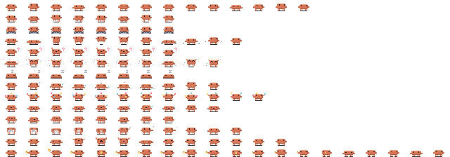

## The sheet

A pet is one PNG. Every frame sits in a cell 32 pixels wide and 16 tall, each animation has its own row, and the frames of a row run left to right. The first empty cell ends the row.



[Download the template](assets/pet-template.png) to start from Clawd's frames.

- The sheet is 192 px tall (12 rows of 16 px), or 224 px (14 rows) if it also has the two idle variants, and `32 × (your longest row)` px wide. A row can have 32 frames at most.
- Only `idle` is required. A pet that has no row for an animation plays `idle` instead, except that a missing `fail` plays `alert` and a missing `pant-walk` plays `walk`.
- A pixel with alpha below 50% is transparent. Fully opaque pixels keep their exact color. The browser can shift the color of a semi-transparent pixel by 1 per channel when it reads the PNG, so soft edges can add near-duplicate colors; export without anti-aliasing. The sheet can have at most 60 colors.
- Art smaller than a cell is fine. The studio trims every frame to the smallest box that holds them all, and the pane gives the pet one terminal row for every two pixel rows of that box. Clawd is 24 × 12, so he takes six rows; the robot uses the full 32 × 16.

## The rows

The rows run top to bottom in this order. The frame time is how long each frame shows by default; you can change it per row in the studio.

| Row | When Ops Control plays it | Frame time | Plays |
| --- | --- | --- | --- |
| `idle` | Nothing is happening | 400 ms | Loops |
| `walk` | Claude reads, searches or plans | 110 ms | Loops |
| `working` | Claude edits files or runs commands | 120 ms | Loops |
| `hop` | A test passes | 120 ms | Once |
| `alert` | Claude needs your approval | 180 ms | Loops |
| `done` | A turn ends | 120 ms | Loops |
| `sleep` | Nothing has happened for a while | 450 ms | Loops |
| `fail` | A test fails | 250 ms | Once |
| `juggle` | Three or more subagents are running | 110 ms | Loops |
| `pant` | The context window is nearly full | 290 ms | Loops |
| `pant-walk` | The same, while walking | 140 ms | Loops |
| `scrunch` | The context is compacted | 150 ms | Once |
| `idle2` | Now and then instead of `idle`, from level 5 | 400 ms | One loop |
| `idle3` | The same from level 10, chosen at random with `idle2` | 400 ms | One loop |

The last two rows are optional, and a 12-row sheet stays valid. When the pet settles back to idle, Ops Control plays `idle2` instead of `idle` about one time in eight once the player is level 5, and from level 10 it picks `idle2` or `idle3` at random. The variant plays one loop and then returns to `idle` at an exit frame, so keep it the same size as `idle` and mark a neutral frame with `exit` in a pet file. A sheet without the row never plays it. The studio and the PNG import take 1 to 14 rows; only `idle`, the first, is required.

See [Pets](pets.md) for what each moment looks like on Clawd.

## Movement

`walk` and `pant-walk` move the pet one pixel to the right for every frame. Draw them facing right: Ops Control mirrors them for the walk back. The other rows stand still, so draw them in place.

## Making the pet

1. Open the [studio](https://glowup.khimani.dev/studio) and go to the Pet section.
2. Upload your PNG, give the pet a name, and set the speed of each row.
3. Choose Send to my Claude in the studio's top bar to copy a `/ops pack …` command, and paste it into Claude Code to install the pet and switch to it. A pet fits in the link when its encoded part is under 4 KB, and the studio tells you when it is too big. For a bigger one, choose Download pet instead.
4. For a downloaded file, run the command below with the path of your download, then switch to the pet.

```text title="claude code"
/ops pet add ~/Downloads/<name>.json
/ops pet <name>
```

`/ops pet add` also takes an `https://` URL to a pet file. It installs the pet in `~/.claude/ops-control/pets` (under `$CLAUDE_CONFIG_DIR` if you set it) without switching, and it refuses a name you already have unless you add `--force`.

## The pet file

The studio writes a JSON file, and you can write one by hand. This is the smallest pet that works:

```json
{
  "format": 1,
  "name": "dot",
  "palette": { "A": "#ff8a3d" },
  "animations": {
    "idle": [
      { "ms": 400, "px": ["..AA..", ".AAAA.", "..AA.."] }
    ]
  }
}
```

Each `px` row is a string with one palette key per pixel, and `.` is a transparent pixel, so it cannot be a palette key. The rules:

- The file is at most 64 KB.
- `name` is lowercase letters, digits and dashes, starts with a letter or digit, and is at most 40 characters. `clawd`, `clawd-shiny`, `egg`, `ghost`, `robot` and the `/ops pet` subcommands are taken.
- `palette` maps single characters to `#rrggbb` colors, 60 at most.
- Frames are at most 32 pixels wide and 16 rows tall, and every frame in the file is the same size.
- `ms` is a whole number from 80 to 10000.
- A row has at most 32 frames, and the animation names are the ones in the table above. An animation or a frame key Ops Control does not know is skipped with a notice.
- A frame can also set `dx`, a whole number from -4 to 4 for how many pixels the pet travels right when the frame shows, and `exit: true` to mark a neutral frame where Ops Control may cut away to the next animation. The last frame of a row that plays once counts as one. An optional `description` is at most 80 characters.

### Lines and voice

A pet can say its own lines and describe itself to Haiku in a file with `"format": 2`. The file then takes two more optional keys:

- `lines` maps a moment (`done`, `fail`, `needs-you`, `green`, `hello`, `long-done`, `compact`, `level-up`) or a moment and a flavour (`done@night`, `hello@christmas`) to a list of 1 to 12 lines. Each line is printable text of at most 40 characters. The flavours are `morning`, `afternoon`, `evening`, `night`, `friday`, `christmas`, `halloween` and `birthday`. A flavour key adds its lines to the moment's pool while that flavour is active. See [Pets](pets.md#what-pets-say) for when each moment speaks.
- `voice` is printable text of at most 120 characters. When bubbles are set to haiku (`/ops bubbles haiku`), it describes the pet to the model that writes the line, in place of the default "a small pixel pet. Friendly and brief."

A key can end in `@lvN`, with N a whole number from 2 to 99, to add its lines to the pool once the player reaches level N: `done@lv4`, or `hello@night@lv7` for a flavour. See [Pets](pets.md#levels) for how levels are earned.

A line can use only the variables its moment fills: `{file}` in `done` and `long-done`, `{n}` in `fail`, `{command}` in `needs-you`, `{unlock}` in `level-up`. `{unlock}` is the name of what the level unlocks, such as "new lines"; when a level-up has an unlock, only lines that use `{unlock}` are considered, so write some of each kind. `hello`, `green` and `compact` take none. An unknown variable, a line over the limit, or more than 12 lines to a key is rejected with the key named. An unknown moment or flavour is skipped with a notice instead, so a pet made for a later release still loads.

A moment with no lines in the file speaks a neutral default line, never another pet's. Using `lines` or `voice` in a `"format": 1` file is an error.

```json
{
  "format": 2,
  "name": "blob",
  "voice": "a sleepy blob. Slow, soft, a bit confused.",
  "lines": {
    "done": ["mm. done", "{file}… better"],
    "hello@morning": ["too early"],
    "green": ["oh nice"]
  },
  "palette": { "a": "#88ccff" },
  "animations": { "idle": [{ "px": ["aa", "aa"], "ms": 400 }] }
}
```

### Files from a later release

A pet file may use a key, animation, moment or flavour that a later 1.x added. Ops Control skips it, shows a notice that names the key and its path, such as `pet "blob": unknown key "lines.dance" skipped`, and loads the rest. A `format` newer than the highest this release reads, which is 2, is the one hard refusal: the file is rejected with "made for a newer Ops Control". A known key with the wrong shape is still an error.

Pets that use 14-row sheets (`idle2` and `idle3`), `@lvN` keys or `level-up` lines need Ops Control 1.0 or later.

Ops Control 0.12 and earlier refuse a format 2 file with a "made for a newer Ops Control" error. The studio opens format 2 files but drops `lines` and `voice` when you export, because it writes format 1.
